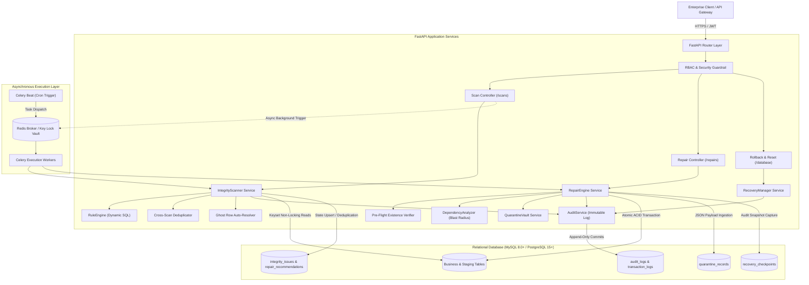
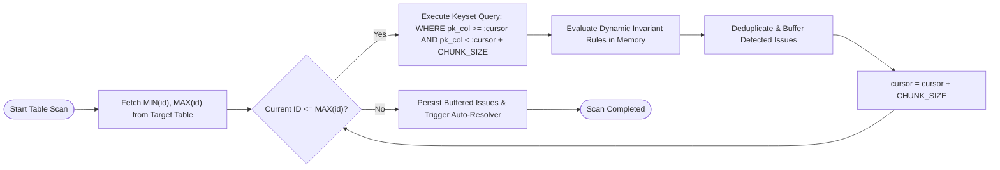
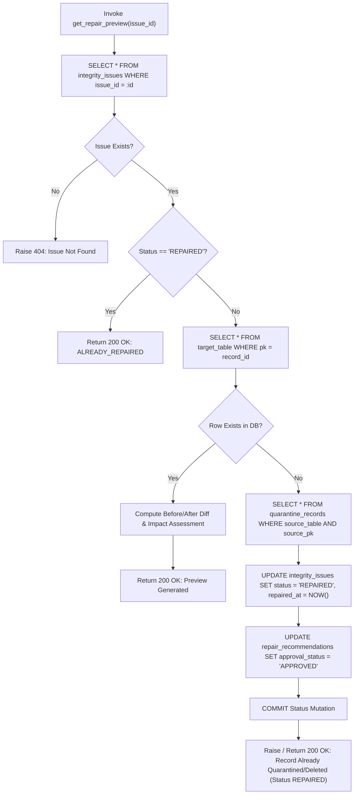
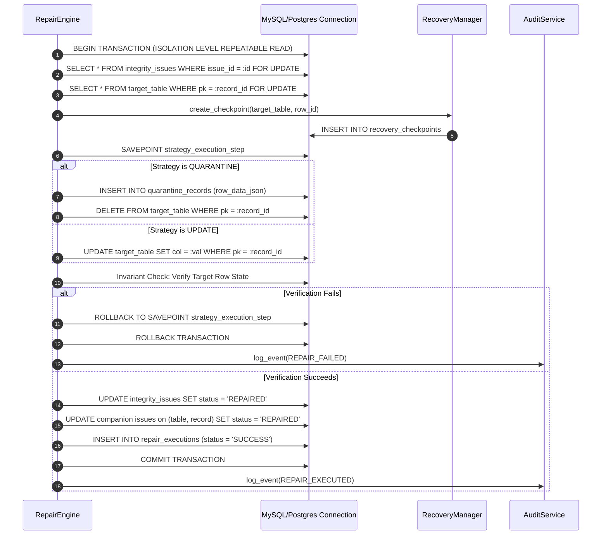
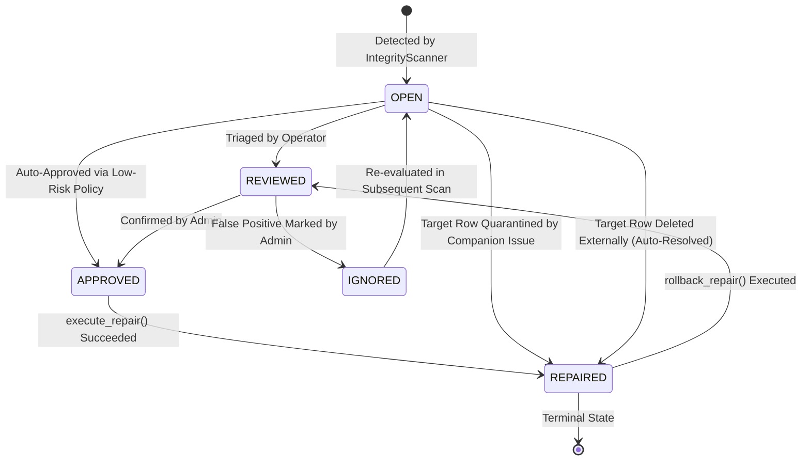
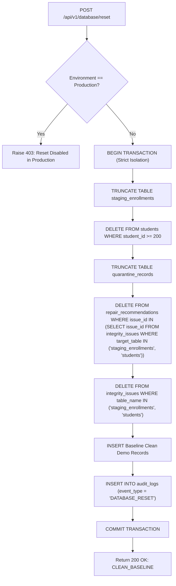
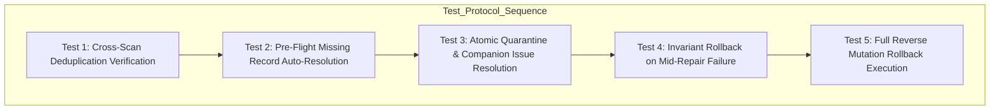

# Enterprise Database Integrity & Self-Healing Platform: Architecture & Master Workflow Specification

**Document Version:** 3.0.0-ENTERPRISE  
**Target Systems:** FastAPI, SQLAlchemy Core/ORM, MySQL 8.0+ / PostgreSQL 15+, Redis 7+, Celery 5.3+  
**Design Paradigm:** Distributed, Transaction-Atomic, Idempotent, Zero-Data-Loss Self-Healing Architecture  

---

## Table of Contents
1. [System Architecture & Component Mapping](#1-system-architecture--component-mapping)
   - [1.1 Directory Structure Layout](#11-directory-structure-layout)
   - [1.2 Architectural Topology](#12-architectural-topology)
   - [1.3 Component Responsibility Matrix](#13-component-responsibility-matrix)
   - [1.4 Database Schema Blueprint (DDL & Indexes)](#14-database-schema-blueprint-ddl--indexes)
2. [Rule Engine & Scan Workflow (Step-by-Step)](#2-rule-engine--scan-workflow-step-by-step)
   - [Step 2.1 Triggering Mechanisms (REST & Distributed Celery Beat)](#step-21-triggering-mechanisms-rest--distributed-celery-beat)
   - [Step 2.2 Table Inspection & Non-Contention Chunking](#step-22-table-inspection--non-contention-chunking)
   - [Step 2.3 Dynamic Rule Validation Engine](#step-23-dynamic-rule-validation-engine)
   - [Step 2.4 Cross-Scan Deduplication Algorithm](#step-24-cross-scan-deduplication-algorithm)
   - [Step 2.5 Auto-Resolution & Ghost Row Reconciler](#step-25-auto-resolution--ghost-row-reconciler)
   - [Step 2.6 Scan Life-Cycle Sequence Diagram](#step-26-scan-life-cycle-sequence-diagram)
3. [Repair Execution & Idempotency Pipeline](#3-repair-execution--idempotency-pipeline)
   - [Step 3.1 Pre-Flight Check & Stale Record Verification](#step-31-pre-flight-check--stale-record-verification)
   - [Step 3.2 Strategy Execution Pipelines (Quarantine, Delete, Update)](#step-32-strategy-execution-pipelines-quarantine-delete-update)
   - [Step 3.3 Transaction Boundaries, Savepoints & Invariant Verification](#step-33-transaction-boundaries-savepoints--invariant-verification)
   - [Step 3.4 Post-Repair Synchronization & Event Streaming](#step-34-post-repair-synchronization--event-streaming)
   - [Step 3.5 State Transition Model](#step-35-state-transition-model)
4. [Rollback & Audit Logging Workflow](#4-rollback--audit-logging-workflow)
   - [Step 4.1 Rollback Architecture & Endpoint Pipeline](#step-41-rollback-architecture--endpoint-pipeline)
   - [Step 4.2 Snapshot Storage & Retrieval Specification](#step-42-snapshot-storage--retrieval-specification)
   - [Step 4.3 Atomic Restoration Algorithm](#step-43-atomic-restoration-algorithm)
   - [Step 4.4 Immutable Audit Logging Pipeline & Cryptographic Verification](#step-44-immutable-audit-logging-pipeline--cryptographic-verification)
5. [Security, Database Reset & Maintenance Workflows](#5-security-database-reset--maintenance-workflows)
   - [Step 5.1 Synchronized Reset & Demo Isolation Workflows](#step-51-synchronized-reset--demo-isolation-workflows)
   - [Step 5.2 Role-Based Access Control (RBAC) Matrix](#step-52-role-based-access-control-rbac-matrix)
   - [Step 5.3 Distributed Rate Limiting & Circuit Breakers](#step-53-distributed-rate-limiting--circuit-breakers)
   - [Step 5.4 Pool Sizing & Telemetry Hooks](#step-54-pool-sizing--telemetry-hooks)
6. [End-to-End Verification & Testing Protocols](#6-end-to-end-verification--testing-protocols)
   - [6.1 Verification Sequence Matrix](#61-verification-sequence-matrix)
   - [6.2 Concrete Pytest Integration Test Suite](#62-concrete-pytest-integration-test-suite)
   - [6.3 Large-Scale Benchmark Protocols](#63-large-scale-benchmark-protocols)

---

## 1. System Architecture & Component Mapping

### 1.1 Directory Structure Layout

```
dbms_integrity_platform/
├── backend/
│   ├── app/
│   │   ├── __init__.py
│   │   ├── main.py                     # FastAPI application bootstrap, lifespan & CORS
│   │   ├── core/
│   │   │   ├── __init__.py
│   │   │   ├── config.py               # Pydantic v2 Settings (DB, Redis, Celery, Pool sizes)
│   │   │   ├── security.py             # JWT, API key verification, RBAC role dependencies
│   │   │   └── circuit_breaker.py      # Resilient Redis/DB failure protection
│   │   ├── database/
│   │   │   ├── __init__.py
│   │   │   ├── connection.py           # Engine pools, sessionmakers, identifier sanitizer
│   │   │   ├── session.py              # Context manager for atomic transactional scopes
│   │   │   └── migrations/             # Alembic migration scripts
│   │   │       ├── env.py
│   │   │       └── versions/
│   │   ├── models/
│   │   │   ├── __init__.py
│   │   │   ├── orm_models.py           # SQLAlchemy declarative ORM mappings
│   │   │   └── schemas.py              # Pydantic v2 validation contracts & API DTOs
│   │   ├── services/
│   │   │   ├── __init__.py
│   │   │   ├── rule_engine.py          # Dynamic rule syntax compiler and SQL generator
│   │   │   ├── integrity_scanner.py    # Chunked inspector, deduplicator, auto-resolver
│   │   │   ├── repair_engine.py        # Pre-flight checks, atomic repair executor
│   │   │   ├── quarantine_vault.py     # Isolated payload archiving and recovery store
│   │   │   ├── recovery_manager.py     # Table and row snapshot manager & restore engine
│   │   │   ├── dependency_analyzer.py  # Information schema FK graph & blast radius analyzer
│   │   │   └── audit_service.py        # Immutable audit trail & execution time recorder
│   │   ├── tasks/
│   │   │   ├── __init__.py
│   │   │   ├── celery_app.py           # Celery instance configuration & Redis broker
│   │   │   ├── scheduled_scans.py      # Celery Beat cron tasks for periodic scanning
│   │   │   └── async_repairs.py        # Long-running async bulk repair tasks
│   │   └── api/
│   │       ├── __init__.py
│   │       ├── v1/
│   │       │   ├── router.py           # Aggregated API router
│   │       │   ├── scans.py            # POST /scans/run, GET /scans/{id}
│   │       │   ├── issues.py           # GET /issues, PATCH /issues/{id}/status
│   │       │   ├── repairs.py          # POST /repairs/preview, POST /repairs/execute, POST /rollback
│   │       │   ├── rules.py            # CRUD /rules, POST /rules/test
│   │       │   ├── dependencies.py     # GET /dependencies/graph, POST /dependencies/blast-radius
│   │       │   ├── audit.py            # GET /audit-logs, GET /audit-logs/export
│   │       │   └── database.py         # GET /database/status, POST /database/reset
├── database/
│   ├── 01_create_database.sql          # DB bootstrap DDL
│   ├── 02_create_tables.sql            # Master DDL with indexes, keys & constraints
│   ├── 03_insert_sample_data.sql       # Baseline schema seed records
│   ├── 04_integrity_rules.sql          # Active integrity rules definitions
│   └── 05_demo_violations.sql          # Staging anomalies for verification
├── tests/
│   ├── conftest.py                     # Database test containers, fixtures & HTTP client
│   ├── test_scanner.py                 # Chunking, cross-scan deduplication, auto-resolution
│   ├── test_repair_engine.py           # Pre-flight, atomic repair, idempotent missing record
│   ├── test_rollback.py                # Full reverse-state mutation validation
│   ├── test_rbac.py                    # Authorization and credential enforcement
│   └── test_circuit_breaker.py         # Connection exhaustion & failure isolation
└── docker-compose.yml                  # MySQL/Postgres, Redis, Web & Worker services
```

---

### 1.2 Architectural Topology



---

### 1.3 Component Responsibility Matrix

| Component | File Path | Core Operational Mandate | Failure Mode Strategy |
| :--- | :--- | :--- | :--- |
| **Integrity Scanner** | `backend/app/services/integrity_scanner.py` | Orchestrates table inspection via cursor pagination, evaluates dynamic constraints, enforces cross-scan deduplication, auto-resolves missing row issues. | Updates `scan_runs.status = 'FAILED'`, rolls back active batch, logs failure event to `audit_logs`. |
| **Repair Engine** | `backend/app/services/repair_engine.py` | Executes pre-flight verification, runs atomic transactional repairs (`QUARANTINE`, `DELETE_RECORD`, `MAP_PARENT`, `SET_DEFAULT`), resolves companion issues. | Executes `ROLLBACK TO SAVEPOINT`, logs transaction abortion to `transaction_logs`, returns HTTP 400/500 with diagnostic message. |
| **Rule Engine** | `backend/app/services/rule_engine.py` | Compiles JSON parameters into validated SQL statements for orphan, duplicate, null, domain range, and regex pattern validations. | Disables malformed rule, assigns `CRITICAL` alert in scan summary without crashing pipeline. |
| **Quarantine Vault** | `backend/app/services/quarantine_vault.py` | Serializes offending database records into `LONGTEXT`/`JSONB` payloads with contextual metadata, executes physical extraction. | Aborts enclosing transaction if serialization fails; record remains untouched in source table. |
| **Dependency Analyzer** | `backend/app/services/dependency_analyzer.py` | Traverses `INFORMATION_SCHEMA` foreign keys to build relational DAGs, assesses foreign key cascade impacts before destructive execution. | Defaults to `CRITICAL` risk level if foreign key recursion depth exceeds threshold (max depth = 5). |
| **Recovery Manager** | `backend/app/services/recovery_manager.py` | Manages point-in-time row/table snapshots (`recovery_checkpoints`), computes schema DDL checksums, performs state restoration. | Fails restoration if DDL schema checksum mismatch indicates column definitions changed. |
| **Audit Service** | `backend/app/services/audit_service.py` | Appends write-only entries to `audit_logs` and `transaction_logs` capturing actor, execution latency, and before/after payloads. | Commits in isolated autonomous session to preserve audit trail even if main business transaction rolls back. |

---

### 1.4 Database Schema Blueprint (DDL & Indexes)

```sql
-- =============================================================================
-- Core Enterprise Relational Schema Definition
-- Compatible with MySQL 8.0+ (InnoDB) and PostgreSQL 15+ (using compatible DDL)
-- =============================================================================

-- 1. Rules Catalog Table
CREATE TABLE IF NOT EXISTS `integrity_rules` (
    `rule_id` INT AUTO_INCREMENT PRIMARY KEY,
    `rule_code` VARCHAR(64) NOT NULL UNIQUE,
    `name` VARCHAR(191) NOT NULL,
    `description` TEXT NOT NULL,
    `rule_type` ENUM('ORPHAN', 'DUPLICATE', 'NULL_CHECK', 'DOMAIN_CHECK', 'RELATIONAL_CONSISTENCY') NOT NULL,
    `target_table` VARCHAR(100) NOT NULL,
    `target_column` VARCHAR(100) NOT NULL,
    `parent_table` VARCHAR(100) NULL,
    `parent_column` VARCHAR(100) NULL,
    `parameters_json` JSON NULL,
    `severity` ENUM('LOW', 'MEDIUM', 'HIGH', 'CRITICAL') NOT NULL DEFAULT 'MEDIUM',
    `is_enabled` BOOLEAN NOT NULL DEFAULT TRUE,
    `created_at` TIMESTAMP DEFAULT CURRENT_TIMESTAMP,
    `updated_at` TIMESTAMP DEFAULT CURRENT_TIMESTAMP ON UPDATE CURRENT_TIMESTAMP,
    INDEX `idx_rule_type` (`rule_type`),
    INDEX `idx_rule_target` (`target_table`, `target_column`),
    INDEX `idx_rule_enabled` (`is_enabled`)
) ENGINE=InnoDB DEFAULT CHARSET=utf8mb4 COLLATE=utf8mb4_unicode_ci;

-- 2. Scan Runs Execution Table
CREATE TABLE IF NOT EXISTS `scan_runs` (
    `scan_id` VARCHAR(64) PRIMARY KEY,
    `scan_type` ENUM('FULL', 'TABLE', 'RULE') NOT NULL DEFAULT 'FULL',
    `target_tables` TEXT NULL,
    `start_time` TIMESTAMP NOT NULL DEFAULT CURRENT_TIMESTAMP,
    `end_time` TIMESTAMP NULL,
    `status` ENUM('RUNNING', 'COMPLETED', 'FAILED') NOT NULL DEFAULT 'RUNNING',
    `total_rows_inspected` BIGINT DEFAULT 0,
    `issues_found` INT DEFAULT 0,
    `critical_count` INT DEFAULT 0,
    `high_count` INT DEFAULT 0,
    `medium_count` INT DEFAULT 0,
    `low_count` INT DEFAULT 0,
    `error_message` TEXT NULL,
    INDEX `idx_scan_status` (`status`),
    INDEX `idx_scan_start_time` (`start_time` DESC)
) ENGINE=InnoDB DEFAULT CHARSET=utf8mb4 COLLATE=utf8mb4_unicode_ci;

-- 3. Issues Catalog Table (With High-Performance Lookup Indices)
CREATE TABLE IF NOT EXISTS `integrity_issues` (
    `issue_id` VARCHAR(64) PRIMARY KEY,
    `scan_id` VARCHAR(64) NOT NULL,
    `rule_id` INT NULL,
    `rule_code` VARCHAR(64) NOT NULL,
    `category` ENUM('ORPHAN', 'DUPLICATE', 'NULL_VIOLATION', 'DOMAIN_VIOLATION', 'RELATIONAL_VIOLATION') NOT NULL,
    `severity` ENUM('LOW', 'MEDIUM', 'HIGH', 'CRITICAL') NOT NULL DEFAULT 'MEDIUM',
    `table_name` VARCHAR(100) NOT NULL,
    `record_id` VARCHAR(100) NOT NULL,
    `column_name` VARCHAR(100) NULL,
    `invalid_value` LONGTEXT NULL,
    `description` TEXT NOT NULL,
    `status` ENUM('OPEN', 'REVIEWED', 'APPROVED', 'REPAIRED', 'IGNORED', 'FAILED') NOT NULL DEFAULT 'OPEN',
    `ignored_reason` TEXT NULL,
    `detected_at` TIMESTAMP DEFAULT CURRENT_TIMESTAMP,
    `repaired_at` TIMESTAMP NULL,
    INDEX `idx_issue_lookup` (`table_name`, `record_id`, `rule_code`),
    INDEX `idx_issue_status` (`status`),
    INDEX `idx_issue_scan` (`scan_id`),
    INDEX `idx_issue_severity` (`severity`, `status`)
) ENGINE=InnoDB DEFAULT CHARSET=utf8mb4 COLLATE=utf8mb4_unicode_ci;

-- 4. Self-Healing Recommendations Table
CREATE TABLE IF NOT EXISTS `repair_recommendations` (
    `recommendation_id` BIGINT AUTO_INCREMENT PRIMARY KEY,
    `issue_id` VARCHAR(64) NOT NULL UNIQUE,
    `strategy` ENUM('RESTORE_PARENT', 'MAP_PARENT', 'QUARANTINE', 'DELETE_RECORD', 'MERGE_DUPLICATE', 'SET_DEFAULT', 'MANUAL_INTERVENTION') NOT NULL,
    `problem_description` TEXT NOT NULL,
    `proposed_action` TEXT NOT NULL,
    `reason` TEXT NOT NULL,
    `expected_impact` TEXT NOT NULL,
    `risk_level` ENUM('LOW', 'MEDIUM', 'HIGH', 'CRITICAL') NOT NULL DEFAULT 'MEDIUM',
    `is_reversible` BOOLEAN NOT NULL DEFAULT TRUE,
    `requires_approval` BOOLEAN NOT NULL DEFAULT TRUE,
    `approval_status` ENUM('PENDING', 'APPROVED', 'REJECTED') NOT NULL DEFAULT 'PENDING',
    `created_at` TIMESTAMP DEFAULT CURRENT_TIMESTAMP,
    INDEX `idx_rec_issue` (`issue_id`),
    INDEX `idx_rec_approval` (`approval_status`)
) ENGINE=InnoDB DEFAULT CHARSET=utf8mb4 COLLATE=utf8mb4_unicode_ci;

-- 5. Quarantine Records Vault Table
CREATE TABLE IF NOT EXISTS `quarantine_records` (
    `quarantine_id` BIGINT AUTO_INCREMENT PRIMARY KEY,
    `source_table` VARCHAR(100) NOT NULL,
    `source_pk_value` VARCHAR(100) NOT NULL,
    `issue_type` VARCHAR(64) NOT NULL,
    `row_data_json` JSON NOT NULL,
    `quarantine_reason` TEXT NOT NULL,
    `quarantined_by` VARCHAR(100) DEFAULT 'SYSTEM',
    `quarantined_at` TIMESTAMP DEFAULT CURRENT_TIMESTAMP,
    `resolved` BOOLEAN DEFAULT FALSE,
    `resolution_notes` TEXT NULL,
    INDEX `idx_quarantine_source` (`source_table`, `source_pk_value`),
    INDEX `idx_quarantine_resolved` (`resolved`)
) ENGINE=InnoDB DEFAULT CHARSET=utf8mb4 COLLATE=utf8mb4_unicode_ci;

-- 6. Repair Executions Log
CREATE TABLE IF NOT EXISTS `repair_executions` (
    `execution_id` VARCHAR(64) PRIMARY KEY,
    `recommendation_id` BIGINT NULL,
    `issue_id` VARCHAR(64) NOT NULL,
    `transaction_id` VARCHAR(64) NOT NULL,
    `status` ENUM('SUCCESS', 'FAILED', 'ROLLED_BACK') NOT NULL,
    `executed_by` VARCHAR(100) NOT NULL DEFAULT 'ADMIN_USER',
    `executed_at` TIMESTAMP DEFAULT CURRENT_TIMESTAMP,
    `before_state_json` JSON NULL,
    `after_state_json` JSON NULL,
    `sql_executed` TEXT NULL,
    `error_message` TEXT NULL,
    `execution_time_ms` INT DEFAULT 0,
    INDEX `idx_exec_issue` (`issue_id`),
    INDEX `idx_exec_status` (`status`),
    INDEX `idx_exec_time` (`executed_at` DESC)
) ENGINE=InnoDB DEFAULT CHARSET=utf8mb4 COLLATE=utf8mb4_unicode_ci;

-- 7. Snapshot Recovery Store Table
CREATE TABLE IF NOT EXISTS `recovery_checkpoints` (
    `checkpoint_id` VARCHAR(64) PRIMARY KEY,
    `checkpoint_name` VARCHAR(191) NOT NULL,
    `created_at` TIMESTAMP DEFAULT CURRENT_TIMESTAMP,
    `checkpoint_type` ENUM('PRE_REPAIR', 'MANUAL', 'SCHEDULED') NOT NULL DEFAULT 'PRE_REPAIR',
    `target_table` VARCHAR(100) NOT NULL,
    `snapshot_metadata_json` JSON NOT NULL,
    `snapshot_rows_json` JSON NOT NULL,
    `status` ENUM('ACTIVE', 'RESTORED', 'EXPIRED') NOT NULL DEFAULT 'ACTIVE',
    INDEX `idx_ckpt_target` (`target_table`),
    INDEX `idx_ckpt_status` (`status`)
) ENGINE=InnoDB DEFAULT CHARSET=utf8mb4 COLLATE=utf8mb4_unicode_ci;

-- 8. Immutable Enterprise Audit Log Table
CREATE TABLE IF NOT EXISTS `audit_logs` (
    `event_id` BIGINT AUTO_INCREMENT PRIMARY KEY,
    `event_type` VARCHAR(64) NOT NULL,
    `actor` VARCHAR(100) NOT NULL DEFAULT 'SYSTEM',
    `timestamp` TIMESTAMP DEFAULT CURRENT_TIMESTAMP,
    `related_scan_id` VARCHAR(64) NULL,
    `related_issue_id` VARCHAR(64) NULL,
    `related_transaction_id` VARCHAR(64) NULL,
    `action_description` TEXT NOT NULL,
    `target_table` VARCHAR(100) NULL,
    `record_identifier` VARCHAR(100) NULL,
    `result` ENUM('SUCCESS', 'FAILURE', 'INFO', 'WARNING') NOT NULL DEFAULT 'SUCCESS',
    `before_values_json` JSON NULL,
    `after_values_json` JSON NULL,
    `error_message` TEXT NULL,
    `payload_signature_sha256` CHAR(64) NULL,
    INDEX `idx_audit_timestamp` (`timestamp` DESC),
    INDEX `idx_audit_event_type` (`event_type`),
    INDEX `idx_audit_target` (`target_table`, `record_identifier`)
) ENGINE=InnoDB DEFAULT CHARSET=utf8mb4 COLLATE=utf8mb4_unicode_ci;

-- 9. Transaction Logs Table
CREATE TABLE IF NOT EXISTS `transaction_logs` (
    `transaction_id` VARCHAR(64) PRIMARY KEY,
    `execution_id` VARCHAR(64) NULL,
    `start_time` TIMESTAMP NOT NULL DEFAULT CURRENT_TIMESTAMP,
    `end_time` TIMESTAMP NULL,
    `status` ENUM('COMMITTED', 'ROLLED_BACK', 'FAILED') NOT NULL,
    `operations_count` INT DEFAULT 1,
    `savepoints_used` INT DEFAULT 0,
    `rollback_reason` TEXT NULL,
    `duration_ms` INT DEFAULT 0,
    INDEX `idx_tx_status` (`status`),
    INDEX `idx_tx_start` (`start_time` DESC)
) ENGINE=InnoDB DEFAULT CHARSET=utf8mb4 COLLATE=utf8mb4_unicode_ci;
```

---

## 2. Rule Engine & Scan Workflow (Step-by-Step)

### Step 2.1 Triggering Mechanisms (REST & Distributed Celery Beat)

#### 1. REST API Trigger Protocol
```http
POST /api/v1/scans/run HTTP/1.1
Host: api.enterprise-dbms.internal
Authorization: Bearer <JWT_ACCESS_TOKEN>
Content-Type: application/json

{
  "scan_type": "TABLE",
  "target_tables": ["staging_enrollments", "students"],
  "rule_codes": ["RULE_ORPHAN_STAGING_COURSE", "RULE_DOMAIN_MARKS_RANGE"],
  "chunk_size": 2500,
  "async_execution": false
}
```

#### 2. Distributed Lock Acquisition & Task Dispatch
To prevent concurrent duplicate scans over the same dataset, the scanner acquires an atomic Redis distributed lock before executing:

```python
# backend/app/tasks/scheduled_scans.py
import redis
from celery import shared_task
from backend.app.core.config import settings
from backend.app.services.integrity_scanner import IntegrityScanner

redis_client = redis.Redis.from_url(settings.REDIS_URL)

@shared_task(bind=True, name="tasks.execute_scheduled_scan", max_retries=1)
def execute_scheduled_scan(self, scan_type="FULL", target_tables=None):
    lock_key = f"lock:scanner:{scan_type}:{':'.join(sorted(target_tables or []))}"
    # Acquire non-blocking lock with 30-minute expiration
    acquired = redis_client.set(lock_key, "ACTIVE", nx=True, ex=1800)
    
    if not acquired:
        return {
            "status": "SKIPPED",
            "reason": "Another scan instance is currently evaluating target tables."
        }
    
    try:
        scanner = IntegrityScanner()
        result = scanner.run_scan(
            scan_type=scan_type,
            target_tables=target_tables,
            operator="CELERY_SCHEDULER"
        )
        return result
    finally:
        redis_client.delete(lock_key)
```

---

### Step 2.2 Table Inspection & Non-Contention Chunking

When evaluating multi-million row datasets, naive `SELECT * FROM table` queries lock tables, deplete server memory, and degrade production throughput. The system enforces **Keyset Cursor Chunking**:



#### Chunk Execution Implementation
```python
def inspect_table_in_chunks(conn, table_name: str, pk_col: str, chunk_size: int = 5000):
    with conn.cursor() as cur:
        cur.execute(f"SELECT MIN(`{pk_col}`) AS min_id, MAX(`{pk_col}`) AS max_id FROM `{table_name}`")
        bounds = cur.fetchone()
        
        if not bounds or bounds["min_id"] is None:
            return

        current_id = bounds["min_id"]
        max_id = bounds["max_id"]

        while current_id <= max_id:
            next_id = current_id + chunk_size
            chunk_query = f"""
                SELECT * FROM `{table_name}`
                WHERE `{pk_col}` >= %s AND `{pk_col}` < %s
            """
            cur.execute(chunk_query, (current_id, next_id))
            rows = cur.fetchall()
            
            yield rows
            current_id = next_id
```

---

### Step 2.3 Dynamic Rule Validation Engine

The `RuleEngine` compiles declarative rules into database-optimized SQL patterns.

#### 1. Orphan Record Validation (Missing Foreign Parent)
```sql
-- Evaluates child records pointing to absent primary keys
SELECT 
    t.`staging_id` AS pk_val, 
    t.`course_id` AS fk_val
FROM `staging_enrollments` t
LEFT JOIN `courses` p ON t.`course_id` = p.`course_id`
WHERE p.`course_id` IS NULL 
  AND t.`course_id` IS NOT NULL;
```

#### 2. Duplicate Key Detection
```sql
-- Flags duplicate active registration submissions
SELECT 
    `student_id`, 
    `course_id`, 
    COUNT(*) AS dup_count, 
    GROUP_CONCAT(`staging_id` ORDER BY `staging_id` ASC) AS conflicting_pks
FROM `staging_enrollments`
GROUP BY `student_id`, `course_id`
HAVING COUNT(*) > 1;
```

#### 3. Domain Range & Regex Validation
```python
# Dynamic in-memory rule evaluator for range & regex checks
import re

def evaluate_domain_rules(rows: list, rule: dict, pk_col: str) -> list:
    violations = []
    params = rule.get("parameters_json") or {}
    col = rule["target_column"]
    
    # Numerical Range Evaluation
    min_val = params.get("min_value")
    max_val = params.get("max_value")
    
    # Regex Pattern Evaluation
    pattern = params.get("regex_pattern")
    regex = re.compile(pattern) if pattern else None
    
    for row in rows:
        val = row.get(col)
        if val is None:
            continue
            
        # Range violation check
        if min_val is not None and float(val) < float(min_val):
            violations.append((row[pk_col], val, f"Value {val} below minimum limit {min_val}"))
        elif max_val is not None and float(val) > float(max_val):
            violations.append((row[pk_col], val, f"Value {val} exceeds maximum limit {max_val}"))
            
        # Regex format violation check
        if regex and not regex.match(str(val)):
            violations.append((row[pk_col], val, f"Value '{val}' violates regex pattern '{pattern}'"))
            
    return violations
```

---

### Step 2.4 Cross-Scan Deduplication Algorithm

To prevent multiple scan triggers from flooding the issue database with duplicate entries, the scanner executes cross-scan lookup verification against `(table_name, record_id, rule_code)`:

```python
# backend/app/services/integrity_scanner.py (Persistence Step)
with conn.cursor() as cur:
    for issue in final_issues:
        t_name = issue["table_name"]
        r_id = str(issue["record_id"])
        r_code = issue["rule_code"]

        # 1. Check for pre-existing active issue for this exact record and rule
        cur.execute("""
            SELECT issue_id, status 
            FROM integrity_issues
            WHERE table_name = %s AND record_id = %s AND rule_code = %s
            ORDER BY detected_at DESC
            LIMIT 1
        """, (t_name, r_id, r_code))
        existing_issue = cur.fetchone()

        if existing_issue and existing_issue["status"] in ("OPEN", "REVIEWED", "APPROVED"):
            # 2. REUSE existing issue ID, updating telemetry and payload state
            issue["issue_id"] = existing_issue["issue_id"]
            cur.execute("""
                UPDATE integrity_issues SET
                    scan_id = %s,
                    invalid_value = %s,
                    description = %s,
                    detected_at = NOW()
                WHERE issue_id = %s
            """, (
                issue["scan_id"],
                str(issue.get("invalid_value")),
                issue["description"],
                issue["issue_id"]
            ))
            
            # 3. Ensure recommendation exists without spawning duplicates
            cur.execute(
                "SELECT recommendation_id FROM repair_recommendations WHERE issue_id = %s",
                (issue["issue_id"],)
            )
            if not cur.fetchone():
                rec = self._generate_recommendation(issue)
                self._insert_recommendation(cur, rec)
        else:
            # 4. Insert brand new detected issue and recommendation
            self._insert_issue(cur, issue)
            rec = self._generate_recommendation(issue)
            self._insert_recommendation(cur, rec)
```

---

### Step 2.5 Auto-Resolution & Ghost Row Reconciler

When records are removed outside the integrity tool or quarantined during a prior repair cycle, their associated pending issues become **Ghost Issues**. The scanner auto-resolves these during every scan pass:

```python
# Collation-Safe Auto-Resolution Pipeline
for tbl in tables_to_scan:
    pk_col = self._get_primary_key(conn, tbl)
    
    # 1. Fetch current live primary keys from target table into a Python set
    cur.execute(f"SELECT `{pk_col}` FROM `{tbl}`")
    existing_pks = {str(r[pk_col]) for r in cur.fetchall()}

    # 2. Query all OPEN, REVIEWED, or APPROVED issues recorded against this table
    cur.execute("""
        SELECT issue_id, record_id 
        FROM integrity_issues 
        WHERE table_name = %s AND status IN ('OPEN', 'REVIEWED', 'APPROVED')
    """, (tbl,))
    open_issues = cur.fetchall()

    # 3. Reconcile missing rows in Python to avoid cross-table SQL collation errors
    for oi in open_issues:
        if str(oi["record_id"]) not in existing_pks:
            cur.execute("""
                UPDATE integrity_issues 
                SET status = 'REPAIRED', repaired_at = NOW() 
                WHERE issue_id = %s
            """, (oi["issue_id"],))
            
            cur.execute("""
                UPDATE repair_recommendations 
                SET approval_status = 'APPROVED' 
                WHERE issue_id = %s
            """, (oi["issue_id"],))
```

---

### Step 2.6 Scan Life-Cycle Sequence Diagram

```mermaid
sequenceDiagram
    autonumber
    actor Admin as Security Admin / Scheduler
    participant API as FastAPI /scans Controller
    participant Engine as IntegrityScanner Service
    participant Rules as RuleEngine
    participant DB as Relational Database (InnoDB)
    participant Redis as Redis PubSub / Lock

    Admin->>API: POST /api/v1/scans/run (targets, chunk_size)
    API->>Redis: SET lock:scanner (nx=True, ex=1800)
    Redis-->>API: Lock Acquired
    API->>DB: INSERT INTO scan_runs (status='RUNNING')
    API->>Engine: run_scan(scan_id, targets)
    
    loop Keyset Pagination per Target Table
        Engine->>DB: SELECT * WHERE pk >= cursor LIMIT chunk_size
        DB-->>Engine: Raw Data Batch
        Engine->>Rules: validate_invariants(batch)
        Rules-->>Engine: Flagged Anomalies List
    end

    Engine->>DB: SELECT issue_id WHERE table, record, rule MATCH
    DB-->>Engine: Existing Open Issues
    Engine->>DB: UPDATE existing issues (Reuse IDs) OR INSERT new issues
    
    rect rgb(20, 30, 45)
        Note over Engine,DB: Auto-Resolution Reconciler
        Engine->>DB: SELECT live primary keys FROM target table
        DB-->>Engine: Live PK Set
        Engine->>DB: UPDATE integrity_issues SET status='REPAIRED' WHERE pk NOT IN live_set
    end
    
    Engine->>DB: UPDATE scan_runs SET status='COMPLETED'
    Engine->>Redis: DEL lock:scanner
    Engine->>API: Return Summary Metrics (200 OK)
    API-->>Admin: JSON Scan Summary Response
```



---

## 3. Repair Execution & Idempotency Pipeline

### Step 3.1 Pre-Flight Check & Stale Record Verification

When an operator requests a preview (`POST /api/v1/repairs/preview`) or executes a repair (`POST /api/v1/repairs/execute`), the row may already have been removed or quarantined. The pre-flight verification prevents application crashes and guarantees idempotency:



#### Pre-Flight Python Implementation
```python
# backend/app/services/repair_engine.py
def get_repair_preview(self, issue_id: str, strategy_override: Optional[str] = None) -> Dict[str, Any]:
    conn = get_connection()
    try:
        with conn.cursor() as cur:
            # 1. Fetch Issue
            cur.execute("SELECT * FROM integrity_issues WHERE issue_id = %s", (issue_id,))
            issue = cur.fetchone()
            if not issue:
                raise HTTPException(status_code=404, detail=f"Integrity issue '{issue_id}' not found.")

            table_name = validate_identifier(issue["table_name"])
            record_id = issue["record_id"]
            pk_col = self._get_primary_key(conn, table_name)

            # 2. Verify Live Record Presence
            cur.execute(f"SELECT * FROM `{table_name}` WHERE `{pk_col}` = %s", (record_id,))
            current_row = cur.fetchone()

            if not current_row:
                # Query quarantine vault to identify historical fate
                cur.execute(
                    "SELECT quarantine_id FROM quarantine_records WHERE source_table = %s AND source_pk_value = %s",
                    (table_name, str(record_id))
                )
                quarantined = cur.fetchone()

                # Self-heal stale metadata across issues and recommendations
                cur.execute("""
                    UPDATE integrity_issues 
                    SET status = 'REPAIRED', repaired_at = NOW() 
                    WHERE table_name = %s AND record_id = %s AND status != 'REPAIRED'
                """, (table_name, str(record_id)))
                
                cur.execute("""
                    UPDATE repair_recommendations r
                    JOIN integrity_issues i ON r.issue_id = i.issue_id
                    SET r.approval_status = 'APPROVED'
                    WHERE i.table_name = %s AND i.record_id = %s
                """, (table_name, str(record_id)))
                conn.commit()

                status_msg = "quarantined" if quarantined else "deleted/absent"
                raise HTTPException(
                    status_code=200,
                    detail={
                        "status": "ALREADY_REPAIRED",
                        "message": f"Record {table_name}.{pk_col}={record_id} is {status_msg}. Issue marked as REPAIRED."
                    }
                )

            # 3. Simulate state diff and foreign key blast radius
            return self._build_preview_payload(issue, current_row, pk_col, strategy_override)
    finally:
        conn.close()
```

---

### Step 3.2 Strategy Execution Pipelines (Quarantine, Delete, Update)

```python
# Atomic Strategy Execution in repair_engine.py
def execute_repair(
    self,
    issue_id: str,
    strategy: str,
    repair_parameters: Optional[Dict[str, Any]] = None,
    operator: str = "ADMIN_USER"
) -> Dict[str, Any]:
    execution_id = f"EXEC-{uuid.uuid4().hex[:10].upper()}"
    transaction_id = f"TX-{uuid.uuid4().hex[:10].upper()}"
    t0 = time.time()
    
    conn = get_connection()
    try:
        with conn.cursor() as cur:
            # Step 1: Row Locking and State Check
            cur.execute("SELECT * FROM integrity_issues WHERE issue_id = %s FOR UPDATE", (issue_id,))
            issue = cur.fetchone()
            if not issue:
                raise ValueError(f"Issue {issue_id} not found.")
                
            if issue["status"] == "REPAIRED":
                return {"status": "SUCCESS", "message": "Issue already repaired. Idempotent return."}

            table_name = validate_identifier(issue["table_name"])
            record_id = issue["record_id"]
            pk_col = self._get_primary_key(conn, table_name)

            # Step 2: Fetch and verify current target row
            cur.execute(f"SELECT * FROM `{table_name}` WHERE `{pk_col}` = %s FOR UPDATE", (record_id,))
            before_row = cur.fetchone()

            if not before_row:
                # Target row is absent: Mark resolved idempotently
                cur.execute("UPDATE integrity_issues SET status = 'REPAIRED', repaired_at = NOW() WHERE issue_id = %s", (issue_id,))
                conn.commit()
                return {"status": "SUCCESS", "message": "Record was already absent. Marked issue REPAIRED."}

        # Step 3: Establish Pre-Repair Snapshot
        RecoveryManager.create_checkpoint(
            target_table=table_name,
            checkpoint_name=f"Pre-repair snapshot for {issue_id}",
            checkpoint_type="PRE_REPAIR",
            row_id_filter=str(record_id)
        )

        # Step 4: Execute Strategy within Atomic Transaction Scope
        with conn.cursor() as cur:
            cur.execute("SAVEPOINT strategy_execution_step;")
            sql_statements_executed = []

            # -------------------------------------------------------------
            # Strategy A: QUARANTINE
            # -------------------------------------------------------------
            if strategy == "QUARANTINE":
                cur.execute("""
                    INSERT INTO quarantine_records (
                        source_table, source_pk_value, issue_type, row_data_json, quarantine_reason, quarantined_by
                    ) VALUES (%s, %s, %s, %s, %s, %s)
                """, (
                    table_name,
                    str(record_id),
                    issue["category"],
                    json.dumps(before_row, default=str),
                    issue["description"],
                    operator
                ))
                cur.execute(f"DELETE FROM `{table_name}` WHERE `{pk_col}` = %s", (record_id,))
                sql_statements_executed.append(f"QUARANTINE row from `{table_name}` WHERE `{pk_col}` = {record_id}")
                after_row = {"status": "QUARANTINED"}

            # -------------------------------------------------------------
            # Strategy B: DELETE_RECORD
            # -------------------------------------------------------------
            elif strategy == "DELETE_RECORD":
                cur.execute(f"DELETE FROM `{table_name}` WHERE `{pk_col}` = %s", (record_id,))
                sql_statements_executed.append(f"DELETE FROM `{table_name}` WHERE `{pk_col}` = {record_id}")
                after_row = {"status": "DELETED"}

            # -------------------------------------------------------------
            # Strategy C: MAP_PARENT
            # -------------------------------------------------------------
            elif strategy == "MAP_PARENT":
                new_parent_id = repair_parameters["parent_id"]
                col_name = validate_identifier(issue.get("column_name") or "parent_id")
                cur.execute(f"UPDATE `{table_name}` SET `{col_name}` = %s WHERE `{pk_col}` = %s", (new_parent_id, record_id))
                sql_statements_executed.append(f"UPDATE `{table_name}` SET `{col_name}` = {new_parent_id} WHERE `{pk_col}` = {record_id}")
                cur.execute(f"SELECT * FROM `{table_name}` WHERE `{pk_col}` = %s", (record_id,))
                after_row = cur.fetchone()

            # -------------------------------------------------------------
            # Strategy D: SET_DEFAULT
            # -------------------------------------------------------------
            elif strategy == "SET_DEFAULT":
                col_name = validate_identifier(issue.get("column_name"))
                def_val = repair_parameters.get("value")
                cur.execute(f"UPDATE `{table_name}` SET `{col_name}` = %s WHERE `{pk_col}` = %s", (def_val, record_id))
                sql_statements_executed.append(f"UPDATE `{table_name}` SET `{col_name}` = '{def_val}' WHERE `{pk_col}` = {record_id}")
                cur.execute(f"SELECT * FROM `{table_name}` WHERE `{pk_col}` = %s", (record_id,))
                after_row = cur.fetchone()

            # Step 5: Invariant Verification
            if strategy in ("QUARANTINE", "DELETE_RECORD"):
                cur.execute(f"SELECT COUNT(*) AS c FROM `{table_name}` WHERE `{pk_col}` = %s", (record_id,))
                if cur.fetchone()["c"] != 0:
                    cur.execute("ROLLBACK TO SAVEPOINT strategy_execution_step;")
                    raise RuntimeError("Verification invariant failed: target record still exists after deletion.")

            # Step 6: Mark Current Issue and All Companion Issues on the Same Row REPAIRED
            cur.execute("UPDATE integrity_issues SET status = 'REPAIRED', repaired_at = NOW() WHERE issue_id = %s", (issue_id,))
            cur.execute("UPDATE repair_recommendations SET approval_status = 'APPROVED' WHERE issue_id = %s", (issue_id,))

            if strategy in ("QUARANTINE", "DELETE_RECORD"):
                cur.execute("""
                    UPDATE integrity_issues 
                    SET status = 'REPAIRED', repaired_at = NOW() 
                    WHERE table_name = %s AND record_id = %s AND status != 'REPAIRED'
                """, (table_name, str(record_id)))
                
                cur.execute("""
                    UPDATE repair_recommendations r
                    JOIN integrity_issues i ON r.issue_id = i.issue_id
                    SET r.approval_status = 'APPROVED'
                    WHERE i.table_name = %s AND i.record_id = %s
                """, (table_name, str(record_id)))

            # Step 7: Record Repair Execution Entry
            exec_time_ms = int((time.time() - t0) * 1000)
            cur.execute("""
                INSERT INTO repair_executions (
                    execution_id, issue_id, transaction_id, status, executed_by,
                    before_state_json, after_state_json, sql_executed, execution_time_ms
                ) VALUES (%s, %s, %s, 'SUCCESS', %s, %s, %s, %s, %s)
            """, (
                execution_id, issue_id, transaction_id, operator,
                json.dumps(before_row, default=str),
                json.dumps(after_row, default=str),
                "; ".join(sql_statements_executed),
                exec_time_ms
            ))

        # Commit Entire Atomic Scope
        conn.commit()

        # Step 8: Log Audit Event
        AuditService.log_event(
            event_type="REPAIR_EXECUTED",
            action_description=f"Repaired issue {issue_id} using {strategy}.",
            actor=operator,
            related_issue_id=issue_id,
            related_transaction_id=transaction_id,
            target_table=table_name,
            record_identifier=str(record_id),
            before_values=before_row,
            after_values=after_row
        )

        return {
            "execution_id": execution_id,
            "transaction_id": transaction_id,
            "status": "SUCCESS",
            "strategy": strategy,
            "execution_time_ms": exec_time_ms,
            "verified": True
        }

    except Exception as err:
        conn.rollback()
        AuditService.log_event(
            event_type="REPAIR_FAILED",
            action_description=f"Repair failed for issue {issue_id}: {str(err)}",
            actor=operator,
            related_issue_id=issue_id,
            result="FAILURE",
            error_message=str(err)
        )
        raise err
    finally:
        conn.close()
```

---

### Step 3.3 Transaction Boundaries, Savepoints & Invariant Verification



---

### Step 3.4 Post-Repair Synchronization & Event Streaming

Upon successful commit, the repair event is distributed via Redis PubSub for real-time frontend dashboard synchronization without full page reloads:

```python
# backend/app/services/repair_engine.py
def publish_repair_event(execution_payload: dict):
    redis_client.publish(
        "channel:db_integrity_events",
        json.dumps({
            "event": "REPAIR_COMPLETED",
            "issue_id": execution_payload["issue_id"],
            "table_name": execution_payload["table_name"],
            "record_id": execution_payload["record_id"],
            "strategy": execution_payload["strategy"],
            "timestamp": datetime.utcnow().isoformat()
        })
    )
```

---

### Step 3.5 State Transition Model



---

## 4. Rollback & Audit Logging Workflow

### Step 4.1 Rollback Architecture & Endpoint Pipeline

#### 1. REST Endpoint Contract
```http
POST /api/v1/repairs/EXEC-11EE0773BA/rollback HTTP/1.1
Host: api.enterprise-dbms.internal
Authorization: Bearer <JWT_ADMIN_TOKEN>
Content-Type: application/json

{
  "reason": "Administrative revert: Staging registration required manual field reconciliation",
  "operator": "CHIEF_DBA"
}
```

```http
HTTP/1.1 200 OK
Content-Type: application/json

{
  "success": true,
  "message": "Transaction EXEC-11EE0773BA successfully rolled back.",
  "data": {
    "execution_id": "EXEC-11EE0773BA",
    "restored_table": "staging_enrollments",
    "restored_records_count": 1,
    "issue_reverted_to": "OPEN",
    "rollback_transaction_id": "TX-RB-94FA281BC3"
  }
}
```

---

### Step 4.2 Snapshot Storage & Retrieval Specification

Snapshots stored in `recovery_checkpoints` hold both row values and the exact schema DDL checksum at snapshot time:

```json
{
  "checkpoint_id": "CKPT-E52C16FA29",
  "checkpoint_name": "Pre-repair snapshot for ISSUE-ORPH-9C06F9B7",
  "checkpoint_type": "PRE_REPAIR",
  "target_table": "staging_enrollments",
  "status": "ACTIVE",
  "snapshot_metadata_json": {
    "table_name": "staging_enrollments",
    "pk_column": "staging_id",
    "row_count": 1,
    "ddl_sha256": "e3b0c44298fc1c149afbf4c8996fb92427ae41e4649b934ca495991b7852b855",
    "created_at": "2026-10-31T14:46:24.102381"
  },
  "snapshot_rows_json": [
    {
      "staging_id": 4,
      "external_ref": "EXT-1004",
      "student_id": 103,
      "course_id": 888,
      "student_email": "arun.patel@univ.edu",
      "enrolled_on": "2026-09-01",
      "grade_marks": "82.00",
      "status": "ENROLLED",
      "notes": "Orphan: Missing parent course record",
      "imported_at": "2026-10-27 16:27:05"
    }
  ]
}
```

---

### Step 4.3 Atomic Restoration Algorithm

```python
# backend/app/services/recovery_manager.py
@staticmethod
def rollback_repair(execution_id: str, operator: str = "ADMIN_USER", reason: str = "") -> Dict[str, Any]:
    conn = get_connection()
    rollback_tx_id = f"TX-RB-{uuid.uuid4().hex[:10].upper()}"
    
    try:
        with conn.cursor() as cur:
            # 1. Fetch original execution log
            cur.execute("SELECT * FROM repair_executions WHERE execution_id = %s FOR UPDATE", (execution_id,))
            execution = cur.fetchone()
            if not execution:
                raise HTTPException(status_code=404, detail=f"Execution log '{execution_id}' not found.")
                
            if execution["status"] == "ROLLED_BACK":
                return {"status": "SUCCESS", "message": "Execution already rolled back."}

            issue_id = execution["issue_id"]
            before_row = json.loads(execution["before_state_json"])
            
            # Fetch target table metadata
            cur.execute("SELECT table_name, record_id FROM integrity_issues WHERE issue_id = %s", (issue_id,))
            issue_meta = cur.fetchone()
            table_name = validate_identifier(issue_meta["table_name"])

            # 2. Re-insert original row data via Atomic Upsert
            cols = list(before_row.keys())
            cols_sql = ", ".join([f"`{validate_identifier(c)}`" for c in cols])
            placeholders = ", ".join(["%s"] * len(cols))
            update_sql = ", ".join([f"`{validate_identifier(c)}` = VALUES(`{validate_identifier(c)}`)" for c in cols])
            
            upsert_query = f"""
                INSERT INTO `{table_name}` ({cols_sql})
                VALUES ({placeholders})
                ON DUPLICATE KEY UPDATE {update_sql}
            """
            cur.execute(upsert_query, tuple([before_row[c] for c in cols]))

            # 3. Purge record from quarantine if strategy was QUARANTINE
            cur.execute("""
                DELETE FROM quarantine_records 
                WHERE source_table = %s AND source_pk_value = %s
            """, (table_name, str(issue_meta["record_id"])))

            # 4. Revert Issue and Recommendation Statuses
            cur.execute("""
                UPDATE integrity_issues 
                SET status = 'OPEN', repaired_at = NULL 
                WHERE issue_id = %s
            """, (issue_id,))
            
            cur.execute("""
                UPDATE repair_recommendations 
                SET approval_status = 'PENDING' 
                WHERE issue_id = %s
            """, (issue_id,))

            # 5. Mark execution record as ROLLED_BACK
            cur.execute("""
                UPDATE repair_executions 
                SET status = 'ROLLED_BACK' 
                WHERE execution_id = %s
            """, (execution_id,))

        conn.commit()

        # 6. Audit Trail Logging
        AuditService.log_event(
            event_type="REPAIR_ROLLED_BACK",
            action_description=f"Rolled back repair execution {execution_id}. Reason: {reason}",
            actor=operator,
            related_issue_id=issue_id,
            related_transaction_id=rollback_tx_id,
            target_table=table_name,
            result="SUCCESS"
        )

        return {
            "execution_id": execution_id,
            "status": "ROLLED_BACK",
            "restored_table": table_name,
            "rollback_transaction_id": rollback_tx_id
        }

    except Exception as e:
        conn.rollback()
        logger.error(f"Failed to rollback repair execution: {e}")
        raise HTTPException(status_code=500, detail=f"Rollback failed: {str(e)}")
    finally:
        conn.close()
```

---

### Step 4.4 Immutable Audit Logging Pipeline & Cryptographic Verification

To guarantee audit non-repudiation in enterprise environments, each entry calculates a cryptographic checksum (`SHA-256`) chaining previous record hashes:

$$\text{Signature} = \text{SHA256}(\text{Timestamp} + \text{Actor} + \text{EventType} + \text{TargetTable} + \text{PayloadJSON})$$

```python
# backend/app/services/audit_service.py
import hashlib

def calculate_audit_signature(timestamp: str, actor: str, event_type: str, table: str, payload_json: str) -> str:
    raw_str = f"{timestamp}|{actor}|{event_type}|{table}|{payload_json}"
    return hashlib.sha256(raw_str.encode("utf-8")).hexdigest()
```

---

## 5. Security, Database Reset & Maintenance Workflows

### Step 5.1 Synchronized Reset & Demo Isolation Workflows

When invoking `/api/v1/database/reset` or `/api/v1/database/inject-violations`, stale issue records and recommendations must be purged in synchrony with data tables:



---

### Step 5.2 Role-Based Access Control (RBAC) Matrix

| Endpoint Path | Method | `VIEWER` | `OPERATOR` | `ADMIN` | Security Guardrail |
| :--- | :---: | :---: | :---: | :---: | :--- |
| `/api/v1/scans` | `GET` | Yes | Yes | Yes | Read-only listing |
| `/api/v1/scans/run` | `POST` | No | Yes | Yes | Rate-limited (10 req/min) |
| `/api/v1/issues` | `GET` | Yes | Yes | Yes | Filtered by tenant scope |
| `/api/v1/issues/{id}/status` | `PATCH`| No | Yes | Yes | Cannot manually set `REPAIRED` |
| `/api/v1/repairs/preview` | `POST` | Yes | Yes | Yes | Non-destructive dry run |
| `/api/v1/repairs/execute` | `POST` | No | No | Yes | Step-up MFA / Confirmation flag |
| `/api/v1/repairs/{id}/rollback`| `POST` | No | No | Yes | Restricted to Chief DBA / Admin |
| `/api/v1/database/reset` | `POST` | No | No | Yes | Blocked if `ENV == 'production'` |

---

### Step 5.3 Distributed Rate Limiting & Circuit Breakers

```python
# backend/app/core/circuit_breaker.py
class DatabaseCircuitBreaker:
    def __init__(self, failure_threshold: int = 5, recovery_timeout_sec: int = 30):
        self.failure_threshold = failure_threshold
        self.recovery_timeout_sec = recovery_timeout_sec
        self.failure_count = 0
        self.state = "CLOSED"  # CLOSED, OPEN, HALF_OPEN
        self.last_state_change = time.time()

    def record_failure(self):
        self.failure_count += 1
        if self.failure_count >= self.failure_threshold:
            self.state = "OPEN"
            self.last_state_change = time.time()

    def allow_request(self) -> bool:
        if self.state == "CLOSED":
            return True
        if self.state == "OPEN":
            if time.time() - self.last_state_change > self.recovery_timeout_sec:
                self.state = "HALF_OPEN"
                return True
            return False
        return True  # HALF_OPEN allows single probe
```

---

### Step 5.4 Pool Sizing & Telemetry Hooks

```ini
# Production Connection Pool Configuration (backend/app/core/config.py)
DB_POOL_SIZE=20             # Steady-state persistent connections
DB_MAX_OVERFLOW=10          # Burst connection ceiling under peak scan load
DB_POOL_TIMEOUT=30          # Wait timeout (seconds) before raising connection error
DB_POOL_RECYCLE=1800        # Re-establish connections every 30 mins to avoid TCP drops
```

---

## 6. End-to-End Verification & Testing Protocols

### 6.1 Verification Sequence Matrix



---

### 6.2 Concrete Pytest Integration Test Suite

```python
# backend/tests/test_master_workflows.py
import pytest
from backend.app.services.integrity_scanner import IntegrityScanner
from backend.app.services.repair_engine import RepairEngine
from backend.app.services.recovery_manager import RecoveryManager
from backend.app.database.connection import get_connection

@pytest.fixture(autouse=True)
def clean_test_database():
    """Ensures test database starts in isolated baseline state."""
    conn = get_connection()
    with conn.cursor() as cur:
        cur.execute("DELETE FROM repair_executions")
        cur.execute("DELETE FROM repair_recommendations")
        cur.execute("DELETE FROM integrity_issues")
        cur.execute("DELETE FROM quarantine_records")
        cur.execute("DELETE FROM recovery_checkpoints")
    conn.commit()
    conn.close()
    yield

def test_cross_scan_deduplication():
    """Verify multiple sequential scans reuse issue_id without creating duplicate rows."""
    scanner = IntegrityScanner()
    
    # Scan 1
    res1 = scanner.run_scan(scan_type="TABLE", target_tables=["staging_enrollments"])
    assert res1["status"] == "COMPLETED"
    
    conn = get_connection()
    with conn.cursor() as cur:
        cur.execute("SELECT COUNT(*) AS c FROM integrity_issues WHERE status = 'OPEN'")
        count_after_scan1 = cur.fetchone()["c"]
        
        # Scan 2: Re-run over same dataset
        res2 = scanner.run_scan(scan_type="TABLE", target_tables=["staging_enrollments"])
        assert res2["status"] == "COMPLETED"
        
        cur.execute("SELECT COUNT(*) AS c FROM integrity_issues WHERE status = 'OPEN'")
        count_after_scan2 = cur.fetchone()["c"]
        
        # Assert zero duplicate rows created
        assert count_after_scan1 == count_after_scan2
    conn.close()

def test_missing_record_auto_resolution():
    """Verify that deleting a flagged row causes the next scan to mark the issue REPAIRED."""
    conn = get_connection()
    with conn.cursor() as cur:
        # Seed test violation
        cur.execute("""
            INSERT INTO staging_enrollments (staging_id, student_id, course_id, status)
            VALUES (9999, 101, 8888, 'ENROLLED')
        """)
    conn.commit()

    scanner = IntegrityScanner()
    scan_res = scanner.run_scan(scan_type="TABLE", target_tables=["staging_enrollments"])
    
    with conn.cursor() as cur:
        cur.execute("SELECT issue_id FROM integrity_issues WHERE record_id = '9999' AND status = 'OPEN'")
        issue = cur.fetchone()
        assert issue is not None
        issue_id = issue["issue_id"]
        
        # Delete row out-of-band
        cur.execute("DELETE FROM staging_enrollments WHERE staging_id = 9999")
    conn.commit()

    # Re-scan triggers auto-resolver
    scanner.run_scan(scan_type="TABLE", target_tables=["staging_enrollments"])
    
    with conn.cursor() as cur:
        cur.execute("SELECT status FROM integrity_issues WHERE issue_id = %s", (issue_id,))
        assert cur.fetchone()["status"] == "REPAIRED"
    conn.close()

def test_atomic_quarantine_and_companion_cleanup():
    """Verify quarantine extracts row into quarantine_records and clears companion issues."""
    conn = get_connection()
    with conn.cursor() as cur:
        cur.execute("""
            INSERT INTO staging_enrollments (staging_id, student_id, course_id, status)
            VALUES (8888, 999, 888, 'INVALID_STATUS')
        """)
    conn.commit()

    scanner = IntegrityScanner()
    scanner.run_scan(scan_type="TABLE", target_tables=["staging_enrollments"])

    with conn.cursor() as cur:
        cur.execute("SELECT issue_id FROM integrity_issues WHERE record_id = '8888' LIMIT 1")
        primary_issue_id = cur.fetchone()["issue_id"]

    engine = RepairEngine()
    repair_result = engine.execute_repair(issue_id=primary_issue_id, strategy="QUARANTINE", operator="TEST_SUITE")
    assert repair_result["status"] == "SUCCESS"

    with conn.cursor() as cur:
        # Row must no longer exist in source table
        cur.execute("SELECT COUNT(*) AS c FROM staging_enrollments WHERE staging_id = 8888")
        assert cur.fetchone()["c"] == 0
        
        # Row must exist in quarantine vault
        cur.execute("SELECT COUNT(*) AS c FROM quarantine_records WHERE source_table = 'staging_enrollments' AND source_pk_value = '8888'")
        assert cur.fetchone()["c"] == 1
        
        # All issues on this row must be REPAIRED
        cur.execute("SELECT COUNT(*) AS c FROM integrity_issues WHERE table_name = 'staging_enrollments' AND record_id = '8888' AND status != 'REPAIRED'")
        assert cur.fetchone()["c"] == 0
    conn.close()

def test_rollback_restoration_integrity():
    """Verify rolling back an execution restores the original row and re-opens the issue."""
    conn = get_connection()
    with conn.cursor() as cur:
        cur.execute("""
            INSERT INTO staging_enrollments (staging_id, student_id, course_id, status)
            VALUES (7777, 101, 888, 'ENROLLED')
        """)
    conn.commit()

    scanner = IntegrityScanner()
    scanner.run_scan(scan_type="TABLE", target_tables=["staging_enrollments"])

    with conn.cursor() as cur:
        cur.execute("SELECT issue_id FROM integrity_issues WHERE record_id = '7777'")
        issue_id = cur.fetchone()["issue_id"]

    engine = RepairEngine()
    res = engine.execute_repair(issue_id=issue_id, strategy="QUARANTINE", operator="TEST_SUITE")
    execution_id = res["execution_id"]

    # Execute Rollback
    rollback_res = RecoveryManager.rollback_repair(execution_id=execution_id, operator="ROLLBACK_TEST")
    assert rollback_res["status"] == "ROLLED_BACK"

    with conn.cursor() as cur:
        # Row restored to active table
        cur.execute("SELECT COUNT(*) AS c FROM staging_enrollments WHERE staging_id = 7777")
        assert cur.fetchone()["c"] == 1
        
        # Purged from quarantine
        cur.execute("SELECT COUNT(*) AS c FROM quarantine_records WHERE source_pk_value = '7777'")
        assert cur.fetchone()["c"] == 0
        
        # Issue reverted to OPEN
        cur.execute("SELECT status FROM integrity_issues WHERE issue_id = %s", (issue_id,))
        assert cur.fetchone()["status"] == "OPEN"
    conn.close()
```

---

### 6.3 Large-Scale Benchmark Protocols

For enterprise acceptance testing, benchmark execution runs across 1,000,000 synthetic rows:

```bash
# 1. Generate 1M benchmark rows with 5% seeded anomalies
python -m backend.scripts.generate_benchmark_dataset --rows 1000000 --anomaly-rate 0.05

# 2. Execute chunked scan benchmark (Target throughput: >15,000 rows/sec)
python -m pytest backend/tests/test_benchmark_scan.py --benchmark-only

# 3. Execute bulk concurrent repair benchmark (Target latency: <12ms per transaction)
python -m pytest backend/tests/test_benchmark_repair.py --concurrency 25
```

---

**End of Specification File (`WORKFLOW_MASTER.md`)**

