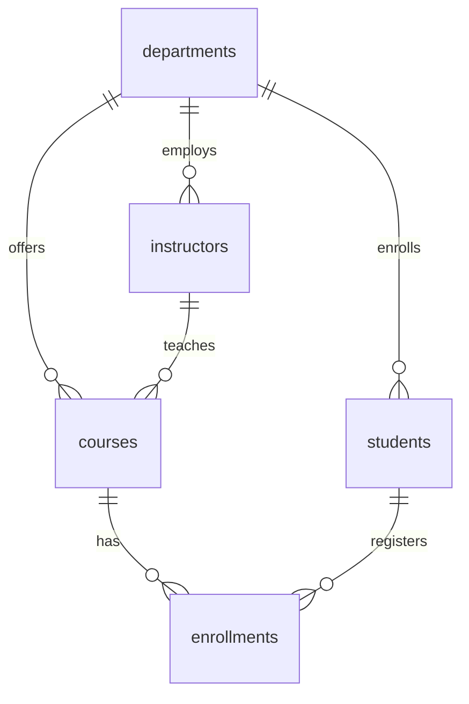

# Database Documentation & Setup Guide

## Overview
The **Self-Healing Relational Database Integrity System** utilizes a high-performance **MySQL InnoDB** relational database configured via XAMPP.

The database `self_healing_test_db` contains two distinct sub-systems:
1. **Academic Business Schema (`departments`, `instructors`, `courses`, `students`, `enrollments`, `staging_enrollments`, `quarantine_records`)**: Demonstrates real-world relational dependencies, strict foreign keys, cascade constraints, and unconstrained staging/migration tables.
2. **Integrity Engine Schema (`integrity_rules`, `scan_runs`, `integrity_issues`, `repair_recommendations`, `repair_executions`, `audit_logs`, `transaction_logs`, `recovery_checkpoints`, `database_metadata`)**: Powers the integrity scanning, dependency mapping, atomic transaction management, recovery checkpoints, and audit trails.

---

## SQL Script Sequence

The scripts in this directory must be executed in the following order:

| File | Purpose | Description |
|---|---|---|
| `01_create_database.sql` | Database Initialization | Creates `self_healing_test_db` with `utf8mb4` charset and InnoDB default storage engine. |
| `02_create_tables.sql` | Schema Definition | Creates all academic tables, staging table, quarantine table, and system engine tables. |
| `03_insert_sample_data.sql` | Baseline Clean Data | Inserts fully consistent baseline records for departments, instructors, courses, students, and enrollments. |
| `04_integrity_rules.sql` | Rules Configuration | Seeds predefined integrity rules across Orphan, Duplicate, NULL, Domain, and Relational categories. |
| `05_demo_violations.sql` | Anomaly Injection | Injects controlled integrity violations (orphans, duplicates, range out-of-bounds, invalid enum, malformed emails) for demonstration. |
| `06_test_queries.sql` | Manual Inspection | Set of verification queries for checking anomalies, orphans, duplicates, and system metrics. |
| `07_reset_demo_data.sql` | Clean State Reset | Safely purges demo anomalies and restores clean baseline data without modifying database schema. |

---

## Import Instructions

### Option A: Using phpMyAdmin (Recommended GUI)
1. Start MySQL in XAMPP Control Panel.
2. Open your browser and navigate to `http://localhost/phpmyadmin/`.
3. Click on the **Import** tab on the top menu bar.
4. Click **Choose File** and select `database/01_create_database.sql`. Click **Go**.
5. Select `self_healing_test_db` from the left sidebar database list.
6. Repeat the Import step sequentially for:
   - `02_create_tables.sql`
   - `03_insert_sample_data.sql`
   - `04_integrity_rules.sql`
   - `05_demo_violations.sql` (to prepare demo scenarios)

### Option B: Using MySQL Command Line Client (PowerShell)
Open PowerShell in the project directory:

```powershell
# Navigate to the project root
cd "d:\DBMS PROJECT\Database_Management_System"

# Execute sequentially into self_healing_test_db:
cmd /c "C:\xampp\mysql\bin\mysql.exe -u root -h 127.0.0.1 < database\01_create_database.sql"
cmd /c "C:\xampp\mysql\bin\mysql.exe -u root -h 127.0.0.1 self_healing_test_db < database\02_create_tables.sql"
cmd /c "C:\xampp\mysql\bin\mysql.exe -u root -h 127.0.0.1 self_healing_test_db < database\03_insert_sample_data.sql"
cmd /c "C:\xampp\mysql\bin\mysql.exe -u root -h 127.0.0.1 self_healing_test_db < database\04_integrity_rules.sql"
cmd /c "C:\xampp\mysql\bin\mysql.exe -u root -h 127.0.0.1 self_healing_test_db < database\05_demo_violations.sql"
```

---

## Entity-Relationship Summary


