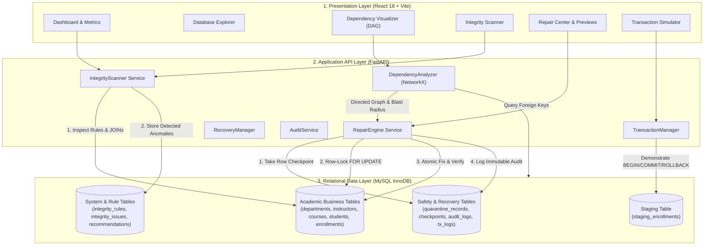
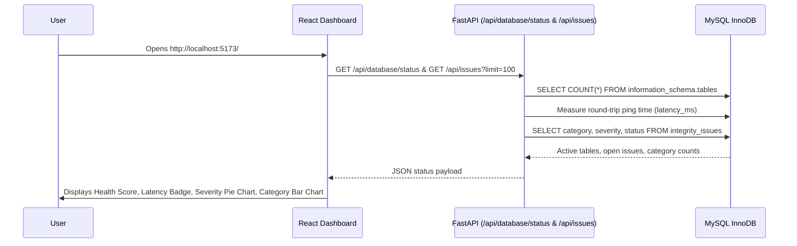
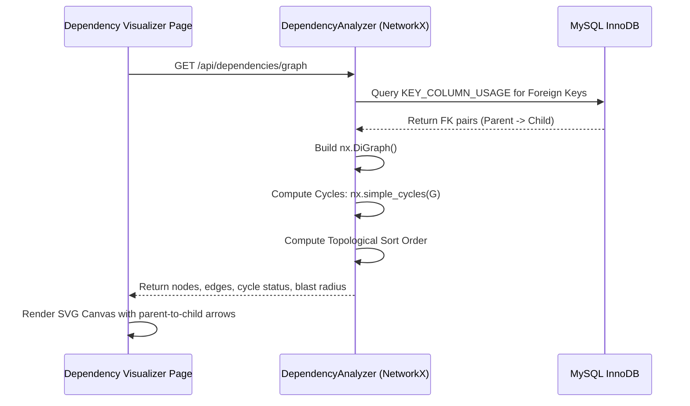
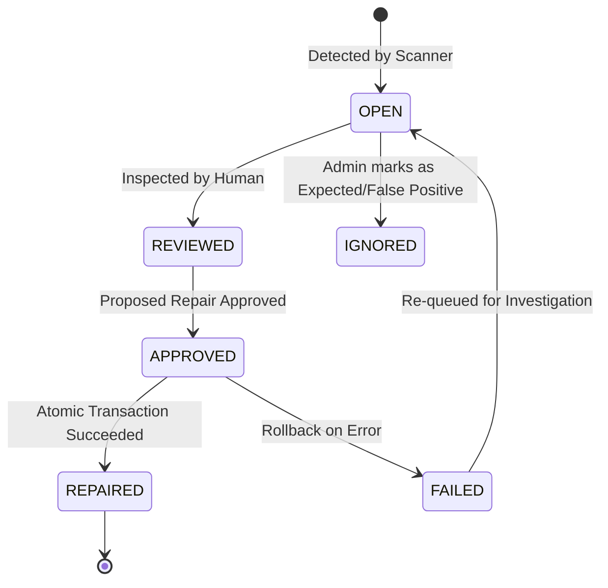
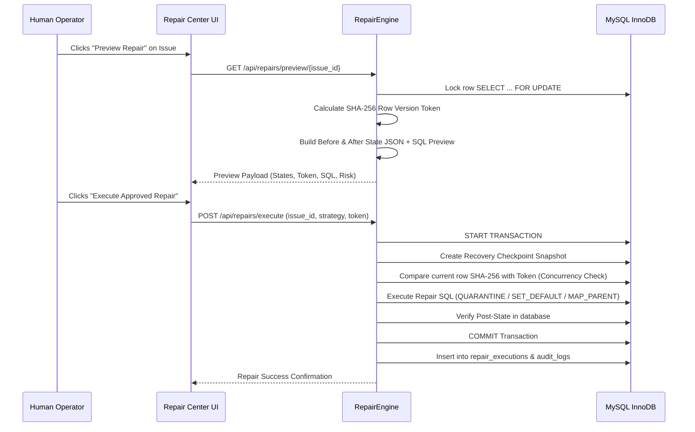

# The Complete Guide to the Self-Healing Relational Database Integrity System
### *From a 10-Year-Old's Perspective to Senior Database Engineer Architecture*

> **Project Version:** 2.4.0  
> **Target Database:** `self_healing_test_db` (MySQL InnoDB / MariaDB via XAMPP)  
> **Stack:** React 18 (Vite + Tailwind CSS + Recharts) + Python FastAPI + PyMySQL + NetworkX  
> **Target Audience:** Anyone wanting to understand the system completely—from school students to university professors and technical examiners.

---

# Part 1: What is This Project? (The 10-Year-Old Story)

### The Giant Lego School Analogy
Imagine you run a giant, super-busy school built completely out of Lego bricks:
* There is a drawer for **Departments** (Science, Math, Arts).
* A drawer for **Teachers** (Dr. Alan, Dr. Ada).
* A drawer for **Courses** (Robotics 101, Space Math).
* A drawer for **Students** (Ravi, Priya, Sneha).
* And a drawer for **Enrollments & Report Cards** (linking which student takes which course and their grades).

In computer language, this giant organized set of drawers is called a **Relational Database**.
"Relational" simply means **the drawers are connected to each other like puzzle pieces!** A report card cannot exist without a real student, and a course must belong to a real department.

---

### The Problem: When Clumsy Hands Make a Mess
Every day, new students join, test scores are typed in, and computers transfer thousands of rows from external files. But humans make mistakes:
1. **The "Ghost Student" (Orphan Record):** Someone writes a report card for student `#999`, but student `#999` doesn't exist anywhere in the school!
2. **The "Clone Disaster" (Duplicate Record):** Someone registers Priya for the exact same Math class twice on the same day.
3. **The "Invisible Kid" (NULL Violation):** Someone created a student record but left the name completely blank `""`!
4. **The "Time Traveler" (Domain Violation):** Someone typed a student's age as `140 years old`, or gave someone a test score of `145 out of 100`!

---

### Why Can't We Just Delete the Mistakes? (The Clumsy Robot Problem)
If you hire a clumsy robot who blindly deletes every mistake it sees, something terrible happens:
> **The Domino Effect (Cascading Destruction):**  
> If the robot deletes a Department because of a typo, the computer might automatically erase all the Teachers in that department, all their Courses, all their Students, and all their Grades! 😱

---

### The Solution: Our Superhero "Self-Healing Database Doctor"
This project is an **Autonomous, Transaction-Safe Self-Healing Relational Database Integrity System**. Think of it as a super-smart robot doctor that:
1. **Puts on X-Ray Glasses:** It scans every drawer without breaking anything to spot mistakes.
2. **Draws a Family Tree (Dependency Graph):** It calculates: *"If I touch this student, will 10 other records fall down like dominoes?"*
3. **Shows a Hologram Preview:** Before making any change, it shows the human operator: *"Here is how the record looks now, here is what I propose to fix, and here is what will happen."*
4. **Always Uses a Safety Net (ACID Transactions & Checkpoints):** It takes a snapshot of the record first. Then, it steps inside a magical safety bubble (`START TRANSACTION`). If anything goes wrong or looks fishy, it hits an emergency rewind button (`ROLLBACK`) so nothing gets corrupted!
5. **Keeps an Unbreakable Diary (Audit Log):** It writes down every single check and fix in a digital black box that no one can tamper with or erase.

---

# Part 2: High-Level Architecture & End-to-End Flow



---

# Part 3: Deep-Dive into Every Website Component

Let us examine all **11 pages** in the application. For each page, you will learn:
* **The 10-Year-Old Explanation**
* **The Direction Flow (What happens behind the scenes)**
* **The Exact Mathematical / Algorithmic Formulas**
* **The Real SQL Queries Executed**

---

## Component 1: System Health & Dashboard (`/`)

### 1. 10-Year-Old Explanation
The Dashboard is the **Doctor's Master Monitor**. Just like the screen in a hospital that shows a patient's heartbeat, blood pressure, and temperature, this page shows if MySQL is alive, how many tables are healthy, and calculates a percentage grade (like getting 95% on a math test) for how clean your database is!

### 2. Direction Flow


### 3. Underlying Formulas & Logic

#### A. Database Health Score Formula
The system estimates overall database purity by comparing clean records against unique records flagged with anomalies:

$$\text{Health Score} = \max\left(0, \; 100 - \left( \frac{U_{\text{issues}}}{N_{\text{total\_records}}} \times 100 \right)\right)$$

Where:
* $U_{\text{issues}}$ = Count of unique problematic records identified by open issues:
  $$U_{\text{issues}} = \left| \{ (table\_name, record\_id) \mid \text{status} = \text{'OPEN'} \} \right|$$
* $N_{\text{total\_records}}$ = Sum of all records across all tables in the database:
  $$N_{\text{total\_records}} = \sum_{T \in \text{Tables}} \text{RowCount}(T)$$

#### B. Severity Distribution Percentage
For any severity bucket $s \in \{\text{CRITICAL}, \text{HIGH}, \text{MEDIUM}, \text{LOW}\}$:

$$\text{Percentage}(s) = \left( \frac{\text{Count}(s)}{\sum_{k} \text{Count}(k)} \right) \times 100$$

### 4. Exact SQL Queries Used
```sql
-- 1. Count registered tables in the schema
SELECT COUNT(*) AS table_count 
FROM information_schema.tables 
WHERE table_schema = 'self_healing_test_db';

-- 2. Inspect active table row counts
SELECT table_name, table_rows 
FROM information_schema.tables 
WHERE table_schema = 'self_healing_test_db';

-- 3. Group open issues by severity for the Recharts pie chart
SELECT severity, COUNT(*) AS count
FROM integrity_issues
WHERE status = 'OPEN'
GROUP BY severity;

-- 4. Group issues by category for the bar chart
SELECT category, COUNT(*) AS count
FROM integrity_issues
GROUP BY category;
```

---

## Component 2: Database Explorer (`/database`)

### 2. 10-Year-Old Explanation
The Explorer is a set of **Transparent Glass Drawers**. Instead of guessing what is inside your database, you can click on any table (like `students` or `courses`) to see the columns, what kind of information they store, and see the actual rows in real time!

### 2. Direction Flow
```
User selects table (e.g. 'courses')
  └──> Frontend calls GET /api/database/schema/courses & GET /api/database/tables/courses/data
        └──> Backend validates table name against strict regex allowlist ^[a-zA-Z_][a-zA-Z0-9_]*$
              └──> Queries INFORMATION_SCHEMA.COLUMNS for data types, nullability, keys
              └──> Queries SELECT * FROM `courses` LIMIT 50
                    └──> Renders schema specification table and live data grid
```

### 3. Formulas & Identifier Security Validation
To prevent **SQL Injection** (hackers trying to enter malicious SQL commands instead of table names), every table and column identifier is passed through a formal regular expression:

$$\text{ValidIdentifier}(w) \iff w \in \mathcal{L}\left( \text{\textasciicircum}[a\text{-}zA\text{-}Z\_][a\text{-}zA\text{-}Z0\text{-}9\_]*\$ \right)$$

If an identifier contains characters like `;`, `'`, `--`, or spaces, the backend rejects it immediately with HTTP 400 before it ever touches MySQL!

### 4. Exact SQL Queries Used
```sql
-- Fetch detailed column metadata (type, nullable, default value, keys)
SELECT 
    column_name, data_type, column_type, is_nullable, 
    column_default, column_key, extra
FROM information_schema.columns
WHERE table_schema = 'self_healing_test_db' 
  AND table_name = 'courses'
ORDER BY ordinal_position;

-- Fetch live row data safely
SELECT * FROM `courses` LIMIT 50 OFFSET 0;
```

---

## Component 3: Relational Dependency Visualizer (`/dependencies`)

### 1. 10-Year-Old Explanation
This is the **Domino Effect Map**. If you touch a parent table (like `departments`), it draws glowing arrows to show who depends on it (`instructors`, `courses`, `students`). It tells you: *"Watch out! If you mess with Department #1, 4 teachers and 12 courses will be affected!"*

### 2. Direction Flow


### 3. Underlying Formulas & Graph Theory
The relational schema is mathematically modeled as a **Directed Graph** $G = (V, E)$:
* **Vertices ($V$):** The set of database tables:
  $$V = \{ \text{departments}, \text{instructors}, \text{courses}, \text{students}, \text{enrollments}, \dots \}$$
* **Directed Edges ($E$):** An arrow from parent table $P$ to child table $C$ if $C$ holds a foreign key pointing to $P$:
  $$e = (P, C) \in E \iff \exists \text{ FK in } C \text{ referencing } P$$

#### A. Directed Cycle Detection
A database schema must never have circular foreign keys (A requires B, B requires C, C requires A), because it would become impossible to insert or delete rows cleanly:

$$\text{HasCycle}(G) \iff \text{nx.is\_directed\_acyclic\_graph}(G) = \text{False}$$

#### B. Cascading Blast Radius Formula
When repairing or deleting a record in table $T$, its **Blast Radius** is the complete transitive closure of all reachable downstream descendant tables:

$$\text{BlastRadius}(T) = \text{Descendants}(G, T) = \{ u \in V \mid \exists \text{ path } T \rightsquigarrow u \}$$

$$\text{BlastRadiusTableCount}(T) = \left| \text{BlastRadius}(T) \right|$$

#### C. Reverse Topological Order (Safe Deletion Order)
To safely clean up records without foreign key constraint violations, children must always be cleaned before parents:

$$\text{Order} = \text{ReverseTopologicalSort}(G)$$

### 4. Exact SQL Queries Used
```sql
-- 1. Discover physical foreign key constraints dynamically
SELECT 
    table_name AS child_table,
    column_name AS child_column,
    referenced_table_name AS parent_table,
    referenced_column_name AS parent_column,
    constraint_name
FROM information_schema.key_column_usage
WHERE table_schema = 'self_healing_test_db'
  AND referenced_table_name IS NOT NULL;

-- 2. Count live child records attached to a specific parent record ID
SELECT COUNT(*) AS matching_rows 
FROM `courses` 
WHERE `dept_id` = '1';
```

---

## Component 4: Integrity Scanner (`/scanner`)

### 1. 10-Year-Old Explanation
The Integrity Scanner is our **Robotic X-Ray Machine**. You press a big blue button: *"Run Full Scan"*, and it goes through every drawer checking 16 rules. If it finds a ghost student, a duplicate email, or an impossible test score, it flags it with a red warning badge!

### 2. Direction Flow
```
User clicks "Run Full Database Scan"
  ├──> Scanner retrieves active rules from integrity_rules
  ├──> Iterates through each rule and builds specific detection SQL
  ├──> Executes query against MySQL InnoDB
  ├──> Deduplicates issues using key (table, record_id, column, category)
  ├──> Inserts detected anomalies into integrity_issues
  ├──> Synthesizes repair proposals into repair_recommendations
  └──> Returns scan summary (total inspected, issues found, duration_ms)
```

### 3. The 5 Mathematical Violation Formulas & SQL Detection Queries

#### Anomaly 1: Orphan Records (Broken Foreign Keys)
* **What it means:** A child record points to a parent ID that does not exist in the parent table.
* **Set Theory Formula:**
  $$\mathcal{O} = \{ r \in \text{Child} \mid r.\text{fk} \neq \text{NULL} \land \neg\exists p \in \text{Parent} \text{ with } p.\text{pk} = r.\text{fk} \}$$
* **Detection SQL:**
  ```sql
  SELECT c.staging_id, c.student_id
  FROM staging_enrollments c
  LEFT JOIN students p ON c.student_id = p.student_id
  WHERE p.student_id IS NULL AND c.student_id IS NOT NULL;
  ```

#### Anomaly 2: Duplicate Records (Candidate Key Collision)
* **What it means:** Two or more rows have the exact same logical key (e.g. same student enrolling in the same course twice).
* **Formula:**
  $$\mathcal{D} = \{ g \in \text{Group}(K) \mid \text{COUNT}(g) > 1 \}$$
  $$\text{Duplicates to Flag} = \text{COUNT}(g) - 1$$
* **Detection SQL:**
  ```sql
  SELECT student_id, course_id, COUNT(*) AS group_count, 
         GROUP_CONCAT(staging_id ORDER BY staging_id ASC) AS id_list
  FROM staging_enrollments
  GROUP BY student_id, course_id
  HAVING COUNT(*) > 1;
  ```

#### Anomaly 3: Mandatory NULL / Empty String Breaches
* **What it means:** A required field like a student's name was left empty or blank.
* **Boolean Formula:**
  $$\text{Violation}(r) \iff (r.\text{col} \text{ IS NULL}) \lor (\text{TRIM}(r.\text{col}) = '')$$
* **Detection SQL:**
  ```sql
  SELECT student_id, student_name
  FROM students
  WHERE student_name IS NULL OR TRIM(student_name) = '';
  ```

#### Anomaly 4: Domain Range Violations (Out-of-Bounds Numbers)
* **What it means:** A number is higher or lower than physically allowed (e.g. test score > 100 or student age > 65).
* **Inequality Formula:**
  $$\text{Violation}(x) \iff (x < \text{MinBound}) \lor (x > \text{MaxBound})$$
* **Detection SQL:**
  ```sql
  SELECT staging_id, grade_marks
  FROM staging_enrollments
  WHERE grade_marks < 0.00 OR grade_marks > 100.00;
  ```

#### Anomaly 5: Domain Enumeration & Regex Violations
* **What it means:** A code is not in the allowed dictionary (e.g. status `'SUSPENDED'` when only `ENROLLED, COMPLETED, DROPPED` are allowed) or an email is missing `@domain.com`.
* **Formulas:**
  $$\text{EnumViolation}(x) \iff x \notin \{\text{'ENROLLED'}, \text{'COMPLETED'}, \text{'DROPPED'}\}$$
  $$\text{RegexViolation}(e) \iff e \not\sim \text{\textasciicircum}[A\text{-}Za\text{-}z0\text{-}9.\_\%\+\-]+@[A\text{-}Za\text{-}z0\text{-}9.\-]+\.[A\text{-}Za\text{-}z]\{2,\}\$$$
* **Detection SQL:**
  ```sql
  SELECT staging_id, status
  FROM staging_enrollments
  WHERE status NOT IN ('ENROLLED', 'COMPLETED', 'DROPPED');
  ```

---

## Component 5: Issue Management (`/issues`)

### 1. 10-Year-Old Explanation
Issue Management is the **Doctor's Clipboard**. When the doctor finds 11 sick records, they are listed here. You can click on any issue to see why it broke, see the raw row data, choose to ignore it (if it's intentional), or click **Preview Repair** to get ready to heal it!

### 2. State Machine Diagram
An issue follows a strict, one-way finite state machine lifecycle:



### 3. Underlying Formulas
* **Cannot Skip to Repaired:** Client cannot set `status = 'REPAIRED'` via API directly. It can ONLY transition to `REPAIRED` when the `RepairEngine` executes inside a genuine MySQL transaction.

---

## Component 6: Repair Center & Non-Destructive Preview (`/repairs`)

### 1. 10-Year-Old Explanation
This is the **Surgery Room with Safety Glass**. You never let a robot perform surgery blindly! First, it shows you a side-by-side hologram:
* **Left side:** How the broken row looks right now.
* **Right side:** How the row will look after the doctor fixes it.
* **Bottom:** The exact SQL code it will execute, and a safety score.
Only when the human clicks **Confirm**, does the surgery take place!

### 2. Direction Flow


### 3. Underlying Formulas & Safety Mathematics

#### A. Deterministic Row-Version Token Formula
To prevent **Race Conditions** (someone else modifying the row while you were looking at the preview), a cryptographic SHA-256 signature is calculated from the canonicalized row state:

$$\text{CanonicalRow} = \text{SortKeys}\left( \{ k: \text{str}(v) \mid (k, v) \in \text{Row} \} \right)$$

$$\text{Token} = \text{SHA-256}\left( \text{JSON}(\text{CanonicalRow}) \right)$$

If the row changes by even one character before you click execute:
$$\text{Token}_{\text{current}} \neq \text{Token}_{\text{preview}} \implies \text{Throw StalePreviewError! (Execution Aborted)}$$

#### B. Risk Classification Matrix
The system evaluates risk deterministically without unpredictable black-box models:

$$\text{RiskLevel} = f(\text{Severity}, \text{IsDestructive}, \text{DependentRowCount}, \text{ChildTableCount})$$

| Issue Severity | Action Is Destructive? | Child Rows Attached? | Resulting Risk Level |
|---|---|---|---|
| **CRITICAL** | Yes (DELETE / QUARANTINE) | Any ($>0$ or $=0$) | **CRITICAL** |
| **CRITICAL** | No (SET_DEFAULT) | No ($=0$) | **HIGH** |
| **HIGH** | Yes | Any | **CRITICAL** |
| **HIGH** | No | Yes ($>0$) | **CRITICAL** |
| **MEDIUM** | Yes | Yes ($>0$) | **CRITICAL** |
| **MEDIUM** | No | No ($=0$) | **LOW** |

### 4. The 4 Executable Healing Strategies & Their Real SQL

#### Strategy 1: `QUARANTINE` (Safest Removal)
* Copies the entire bad row into a safe archive table (`quarantine_records`) as JSON before deleting it from the active table:
```sql
-- Step 1: Copy to Quarantine Landing Zone
INSERT INTO quarantine_records 
    (source_table, source_pk_value, issue_type, row_data_json, quarantine_reason, quarantined_by)
VALUES 
    ('staging_enrollments', '3', 'ORPHAN', '{"staging_id": 3, "student_id": 999, ...}', 'Orphan student 999', 'ADMIN_USER');

-- Step 2: Delete from active table
DELETE FROM staging_enrollments WHERE staging_id = 3;
```

#### Strategy 2: `SET_DEFAULT` (Controlled Imputation)
* Replaces an illegal or missing value with a validated default or admin-provided value:
```sql
UPDATE students 
SET student_name = 'Alex Hunter' 
WHERE student_id = 204;
```

#### Strategy 3: `MAP_PARENT` (Relational Re-linking)
* Fixes an orphan record by attaching it to an authoritative, existing parent ID:
```sql
UPDATE staging_enrollments 
SET student_id = 101 
WHERE staging_id = 3;
```

#### Strategy 4: `DELETE_RECORD` (Permanent Purge)
```sql
DELETE FROM staging_enrollments WHERE staging_id = 6;
```

---

## Component 7: Transaction Simulator (`/transactions`)

### 1. 10-Year-Old Explanation
The Transaction Simulator is our **Time Machine**. Imagine playing a video game where before trying a dangerous jump, you hit "Save Game". If you miss the jump, you hit "Reload Save" and nothing was lost!
In relational databases, this magical superpower is called **ACID Transactions** (`START TRANSACTION`, `SAVEPOINT`, and `ROLLBACK`).

### 2. The 3 Demonstrations Explained

#### Demonstration A: `COMMIT_SUCCESS`
* **What happens:** Starts transaction, adds a row, verifies the row exists, and commits. The change becomes permanent!
* **Count Formula:**
  $$\text{Count}_{\text{final}} = \text{Count}_{\text{initial}} + 1$$

#### Demonstration B: `SIMULATED_FAILURE_ROLLBACK`
* **What happens:** Starts transaction, adds a row, simulates an unexpected error (like power loss or crash), and calls `ROLLBACK`.
* **Count Formula (Atomicity Guarantee):**
  $$\text{Count}_{\text{final}} = \text{Count}_{\text{initial}} \quad (\text{Zero traces left behind!})$$

#### Demonstration C: `SAVEPOINT_PARTIAL_ROLLBACK`
* **What happens:** Starts transaction, inserts Record A, creates a bookmark (`SAVEPOINT sp1`), tries to insert bad Record B, hits an error, rolls back only to `sp1`, and commits Record A!
* **Result:** Record A stays saved; Record B vanishes!

### 3. Exact SQL Queries Used
```sql
-- Scenario C Execution Sequence
START TRANSACTION;

-- Operation 1: Insert Record A
INSERT INTO staging_enrollments (staging_id, external_ref, student_id, course_id, status)
VALUES (9001, 'TX-DEMO-A', 101, 1, 'ENROLLED');

-- Operation 2: Set Savepoint
SAVEPOINT step_a_complete;

-- Operation 3: Attempt Invalid Record B
INSERT INTO staging_enrollments (staging_id, external_ref, student_id, course_id, status)
VALUES (9002, 'TX-DEMO-B', 999, 999, 'INVALID');

-- Operation 4: Partial Rollback
ROLLBACK TO SAVEPOINT step_a_complete;

-- Operation 5: Commit surviving operations
COMMIT;
```

---

## Component 8: Recovery Center (`/recovery`)

### 1. 10-Year-Old Explanation
The Recovery Center is the **Magic Photocopy Machine**. Before we let the doctor fix a table, it makes an exact snapshot photocopy of every row and column. If you ever say: *"Oops! I preferred the way it was before!"*, you click **Restore**, and the table snaps back to the exact snapshot!

### 2. Underlying Formulas & Verification Math
A restore is considered mathematically valid if and only if:

$$\text{ExpectedRows} = \left| \text{SnapshotRows} \right|$$

$$\text{ActualRows} = \text{SELECT COUNT}(*) \text{ FROM } \text{TargetTable}$$

$$\text{IsVerified} \iff (\text{ExpectedRows} = \text{ActualRows}) \land \left( \forall k \in \text{SnapshotPKs}, \; k \in \text{TablePKs} \right)$$

### 3. Exact SQL Queries Used
```sql
-- 1. Create a Snapshot Checkpoint
SELECT * FROM `departments`;
INSERT INTO recovery_checkpoints 
    (checkpoint_id, checkpoint_name, checkpoint_type, target_table, snapshot_metadata_json, snapshot_rows_json, status)
VALUES 
    ('CKPT-1234', 'Pre-Repair Snapshot', 'PRE_REPAIR', 'departments', '{"columns": [...]}', '[{"dept_id":1,...}]', 'ACTIVE');

-- 2. Restore from Checkpoint inside transaction
START TRANSACTION;
-- Upsert snapshot rows
INSERT INTO `departments` (dept_id, dept_code, dept_name, building, budget)
VALUES (1, 'CS', 'Computer Science and Engineering', 'Turing Hall', 850000.00)
ON DUPLICATE KEY UPDATE 
    dept_code = VALUES(dept_code), dept_name = VALUES(dept_name), 
    building = VALUES(building), budget = VALUES(budget);
COMMIT;
```

---

## Component 9: Audit Logs (`/audit`)

### 1. 10-Year-Old Explanation
The Audit Log is the **Airplane Flight Recorder (Black Box)**. Every time someone runs a scan, approves a repair, or touches a table, the system writes it in an unbreakable diary. Even if someone tries to hack in and delete the logs, MySQL triggers will say: *"ACCESS DENIED! You are not allowed to erase history!"*

### 2. Direction Flow & Sensitive Credential Redaction
```
Any System Event
  └──> AuditService.log_event(...)
        ├──> Sanitizes JSON payload: Replaces keys containing 
        │    ['password', 'secret', 'token', 'pwd', 'hash', 'credit_card'] 
        │    with '[REDACTED]'
        └──> Inserts row into audit_logs table
```

### 3. Database Triggers Enforcing Immutability
These triggers are installed directly into MySQL InnoDB so that no user (not even an administrator) can alter or delete audit history:

```sql
DELIMITER $$

CREATE TRIGGER `trg_audit_logs_no_update`
BEFORE UPDATE ON `audit_logs`
FOR EACH ROW
BEGIN
    SIGNAL SQLSTATE '45000'
    SET MESSAGE_TEXT = 'CRITICAL: audit_logs entries are immutable and cannot be updated.';
END$$

CREATE TRIGGER `trg_audit_logs_no_delete`
BEFORE DELETE ON `audit_logs`
FOR EACH ROW
BEGIN
    SIGNAL SQLSTATE '45000'
    SET MESSAGE_TEXT = 'CRITICAL: audit_logs entries are immutable and cannot be deleted.';
END$$

DELIMITER ;
```

---

## Component 10: Rules Configuration (`/rules`)

### 1. 10-Year-Old Explanation
This is the **School Rulebook**. Here you can turn rules on or off with a switch, change maximum student age from 65 to 70, or create a new rule for a new table. You can also click "Test Rule" to see how many broken records it finds before saving!

### 2. SQL Schema for Rules
```sql
CREATE TABLE IF NOT EXISTS `integrity_rules` (
    `rule_id` INT AUTO_INCREMENT PRIMARY KEY,
    `rule_code` VARCHAR(50) NOT NULL UNIQUE,
    `name` VARCHAR(150) NOT NULL,
    `description` TEXT NOT NULL,
    `rule_type` ENUM('ORPHAN', 'DUPLICATE', 'NULL_CHECK', 'DOMAIN_CHECK', 'RELATIONAL_CONSISTENCY') NOT NULL,
    `target_table` VARCHAR(100) NOT NULL,
    `target_column` VARCHAR(100) NOT NULL,
    `parent_table` VARCHAR(100) NULL,
    `parent_column` VARCHAR(100) NULL,
    `parameters_json` LONGTEXT NULL,
    `severity` ENUM('LOW', 'MEDIUM', 'HIGH', 'CRITICAL') NOT NULL DEFAULT 'MEDIUM',
    `is_enabled` BOOLEAN NOT NULL DEFAULT TRUE
);
```

---

## Component 11: Settings & Diagnostics (`/settings`)

### 1. 10-Year-Old Explanation
The Settings page is the **Testing Lab**. It tells you if the wire connecting FastAPI to MySQL is fast (e.g. 80 milliseconds latency). It also has two magic test buttons:
1. **Inject Demo Violations:** Adds 11 controlled mistakes into the database so you can demonstrate the scanner to your teacher!
2. **Reset Baseline Data:** Cleans out all demo mistakes and restores the database to a 100% clean, pristine state!

---

# Part 4: Complete Summary of the 16 Database Tables

| Table Name | Category | Primary Key | What it Stores (Kid Explanation) |
|---|---|---|---|
| `departments` | Business | `dept_id` | School subjects (Computer Science, Math, Electrical). |
| `instructors` | Business | `instructor_id` | Professors (Dr. Alan Turing, Dr. Ada Lovelace). |
| `courses` | Business | `course_id` | Classes students take (CS101, Discrete Math). |
| `students` | Business | `student_id` | Student profiles (Ravi, Priya, Sneha). |
| `enrollments` | Business | `enrollment_id` | Official report cards connecting students to courses. |
| `staging_enrollments` | Staging | `staging_id` | Unconstrained sandbox table where raw imported records land. |
| `quarantine_records` | Safety | `quarantine_id` | Safe storage locker where broken rows are saved before deletion. |
| `integrity_rules` | Engine | `rule_id` | The rulebook defining what is considered a mistake. |
| `scan_runs` | Engine | `scan_id` | History of when scans were performed and how many bugs were found. |
| `integrity_issues` | Engine | `issue_id` | The list of all currently detected sick records. |
| `repair_recommendations`| Engine | `recommendation_id` | The doctor's treatment plans for each issue. |
| `repair_executions` | Engine | `execution_id` | The record of every surgery performed and its timing. |
| `audit_logs` | Audit | `event_id` | The unbreakable flight recorder diary. |
| `transaction_logs` | Audit | `transaction_id` | Low-level commit/rollback/savepoint ledger. |
| `recovery_checkpoints` | Safety | `checkpoint_id` | Full table snapshot photocopies for one-click restoration. |
| `database_metadata` | System | `meta_key` | System name, version (2.4.0), and initialization date. |

---

# Part 5: Viva / Exam Defense Cheat Sheet (Q&A)

### Q1: What makes this project different from a standard CRUD website?
**Answer:** A standard CRUD application just creates, reads, updates, and deletes records blindly. This project is a **database meta-engine**: it reads database structure dynamically from `INFORMATION_SCHEMA`, builds a directed graph with `NetworkX` to evaluate cascading side-effects, generates non-destructive repair previews with cryptographic row-version checking, and applies fixes inside rollback-protected InnoDB ACID transactions with recovery checkpoints.

### Q2: Does this project use Machine Learning?
**Answer:** **No, and deliberately so.** In relational database management systems, data integrity requires **100% deterministic, verifiable mathematical proofs**, not probabilistic guesses. Detection is based on formal relational algebra (`LEFT JOIN`, `GROUP BY ... HAVING`, domain predicates), and graph traversal uses deterministic cycle detection and topological sorting.

### Q3: Why is there a `staging_enrollments` table without foreign keys?
**Answer:** In real enterprise databases (like banks or universities), data imported from external Excel sheets or third-party APIs lands in unconstrained staging tables first. If we had physical foreign keys on staging tables, MySQL would reject the entire file on the first error. Having an unconstrained staging table allows the system to accept raw data, scan for anomalies, and heal them before promoting records into production tables (`enrollments`).

### Q4: What is a "Blast Radius"?
**Answer:** Blast Radius is the set of all downstream child and grandchild tables that would be impacted if a record in a parent table is modified or deleted. It is calculated by finding all reachable nodes from the target table in our directed dependency graph: $\text{BlastRadius}(T) = \text{Descendants}(G, T)$.

### Q5: How does the system prevent race conditions during repairs?
**Answer:** During the preview step, the engine computes a **SHA-256 Row-Version Token** of the canonicalized record. Before executing the repair, the engine begins a transaction, locks the row using `SELECT ... FOR UPDATE`, and re-computes the hash. If another user modified the row in the meantime, the tokens will not match, and the engine aborts the transaction with `StalePreviewError`.
